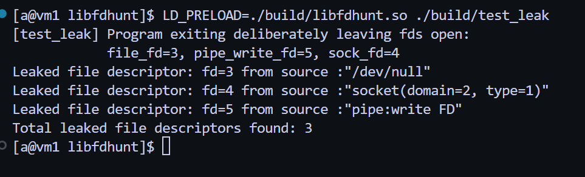

# libfdhunt

## A lightweight LD_PRELOAD shared library that catches and reports unclosed file descriptor leaks in Linux binaries at process exit. 

Works via interposing at the dynamic linker boundary, requiring no source code modification, recompilation, or runtime binary translation. 

### **Rationale**


File descriptor leaks in long-running Linux processes - such as network daemons, microservices, DB daemons, etc. are notoriously difficult to diagnose. Left unchecked, they trigger hard operating system limits (`EMFILE` / `ENFILE`), leading to sudden connection drops, failed I/O paths, and service crashes.


Existing diagnostic approaches introduce significant operational trade-offs:

* **Valgrind (`--track-fds=yes`):** Employs full dynamic binary translation, imposing a 10x–50x performance penalty. This artificial latency alters thread scheduling and event-loop timing, often masking race conditions and preventing the bug from reproducing.


* **External Inspection (`/proc/$PID/fd`, `lsof`):** Relies on out-of-band polling. 
Capturing short-lived descriptors or debugging transient processes that exit rapidly creates a timing window that external sampling frequently misses.

```libfdhunt``` operates directly inside the process address space at native execution speeds. Descriptors are registered in an internal $O(1)$ table during syscall wrapper execution and swept during standard process termination, reporting unclosed handles directly to `stderr`.


## Comparison & Prior Art

| Approach | Setup / Permissions | Runtime Overhead | Detects Short-Lived / Fast-Exiting Leaks? | Alters Thread Scheduling? |
| :--- | :--- | :--- | :--- | :--- |
| **`libfdhunt`** (`LD_PRELOAD`) | Zero setup, unprivileged user | Near-zero (native speed, $O(1)$) | Yes (sweeps at process exit) | No |
| **Valgrind** (`--track-fds=yes`) | Standard package install | **10x–50x slowdown** (CPU emulation) | Yes | **Yes** (masks race conditions) |
| **eBPF / BCC / bpftrace** | **Requires root / `CAP_BPF`, kernel BTF headers** | Low (kernel-level) | Difficult (requires external trace capture) | No |
| **Manual inspection (`/proc/$PID/fd`, `lsof`)** | Unprivileged / process owner | None | **No** (polling misses quick exits) | No |

### Why not Valgrind?
Valgrind’s `--track-fds=yes` is the gold standard for full program inspection, but dynamic binary translation incurs massive overhead. For long integration suites, high-throughput network services, or timing-dependent bugs, that 10x–50x penalty frequently alters thread interleaving, masks race conditions, and makes tests take hours instead of minutes. `libfdhunt` runs at native CPU speed.

### Why not eBPF?
eBPF is powerful for host-wide observability, but requires root privileges (`CAP_SYS_ADMIN` or `CAP_BPF`), modern Linux kernel headers, and BTF support. In locked-down enterprise CI/CD runners, unprivileged Docker containers, or shared machines where you lack root access, loading eBPF programs is impossible. `libfdhunt` operates purely in userspace with standard user permissions.

### Why not `/proc/$PID/fd` or `lsof`?
Out-of-band polling requires the target process to be alive while you sample it. If a worker process spawns, leaks a descriptor in an error branch, and terminates, polling tools miss the execution window entirely. `libfdhunt` lives inside the address space and intercepts exit teardown directly.


## **How it works**

```libfdhunt``` hooks into the dynamic linker boundary using LD_PRELOAD. It intercepts standard glibc system calls (such as open, socket, and pipe) before they execute, logging descriptor lifecycles and passing execution through to the underlying runtime via dlsym(RTLD_NEXT).


## **Implementation flow**


- Preload process under scrutiny with `libfdhunt.so`
- Target process invokes a glibc syscall wrapper (e.g., `open`, `pipe2`, `socket`, `close`)
- `libfdhunt.so` intercepts the call (`src/interceptor.c`):
    - Check thread-local re-entry guard
    - Resolve real glibc symbol via `dlsym(RTLD_NEXT)`
    - Execute original glibc wrapper
    - On descriptor creation (`fd >= 0`): register handle via `add_fd_to_tracker(fd, tag)` (`src/tracker.c`)
    - On descriptor teardown (`close`): evict handle via `remove_fd_from_tracker(fd)` (`src/tracker.c`)
    - Reset thread-local re-entrancy guard
- Process terminates normally (`exit()` or return from `main`)
- Shared library destructor (`libfdhunt_cleanup`) triggers `report_fd_leaks()`:
    - Scans tracking table for unclosed descriptors
    - Prints itemized leaks to `stderr`, or prints `No leaked file descriptors detected.`


### **Features**

#### **What it tracks:**


```libfdhunt``` intercepts the following glibc syscall wrappers:

* **Files:** `open`, `openat`
* **Sockets:** `socket`, `accept`, `accept4`, `socketpair`
* **Pipes:** `pipe`, `pipe2`
* **Duplication:** `dup`, `dup2`, `dup3`
* **Event & Timing Primitives:** `epoll_create`, `epoll_create1`, `eventfd`, `timerfd_create`
* **Signals & Monitoring:** `signalfd`, `inotify_init`, `inotify_init1`
* **Memory & Process Handles:** `memfd_create`, `pidfd_open`
* **Asynchronous I/O:** `io_uring_setup`
* **Teardown:** `close`


#### **Self Re-rentry call guard**

Resolving symbols using dynamic interposition like ```dlsym``` here can cause glibc to trigger the very call it's interposing, leading to circular recursion.
```libfdhunt``` prevents this using a thread-local guard that detects self - re-entry and passes internal calls straight through.


#### **Flat direct-indexed descriptor tracker**


The tracker register in ```src/tracker.c``` is a flat array indexed directly by the file descriptor number (```fd_table[fd]```), This ensures:
- O(1) for all fd insert, lookup and deletions.
- Memory is initialized once with calloc() on the first intercepted call, requiring zero dynamic allocations thereafter.
- Thread synchronization is handled with a single ```pthread_mutex_t``` around array updates


## **Build**

Simple ```make``` build using given Makefile. 


## **Usage**


Preload ```libfdhunt.so``` against the program under scrutiny for leaks

```LD_PRELOAD=/path/to/libfdhunt.so /path/to/your_program [args]```


## **Design constraints & caveats**


**Direct syscalls** 

```libfdhunt``` intercepts glibc library wrappers via dynamic linking. Binaries that invoke kernel syscalls directly—such as via `syscall(2)`, raw assembly interrupts (`syscall` / `int 0x80`), or Go runtimes that bypass libc—will not be intercepted.it bypasses glibc.


**Abnormal Process Termination** 

Destructors only execute on normal exit (exit(3) or returning from main()). Fatal signals (SIGKILL, SIGSEGV) or direct calls to _exit(2) bypass cleanup, so no leak report will be generated.


**Inherited Descriptors** 

Descriptors already open when ```libfdhunt``` loads—such as inherited standard streams or file descriptors passed across execve(2) from a parent process are not tracked. Only descriptors allocated through intercepted libc calls during the program's own runtime are registered.


## Example Demo Output


This is a demo output of `libfdhunt` catching and reporting unclosed file descriptors at process exit:




## LICENSE


This project is licensed under MIT License